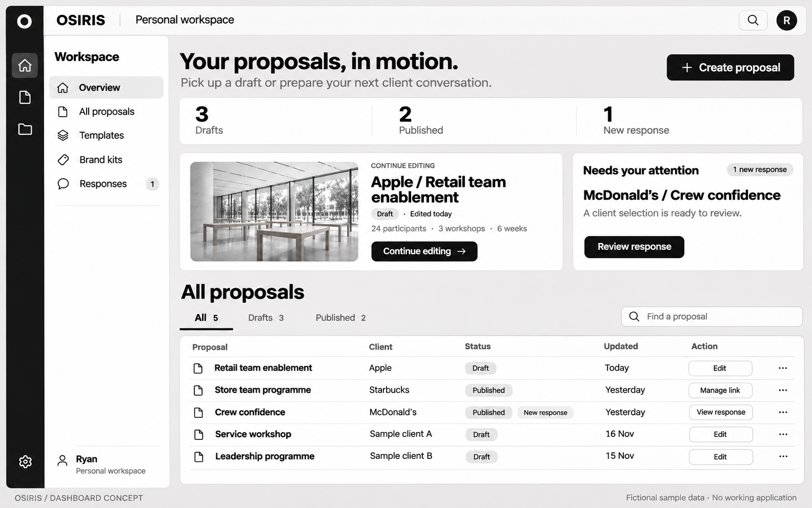
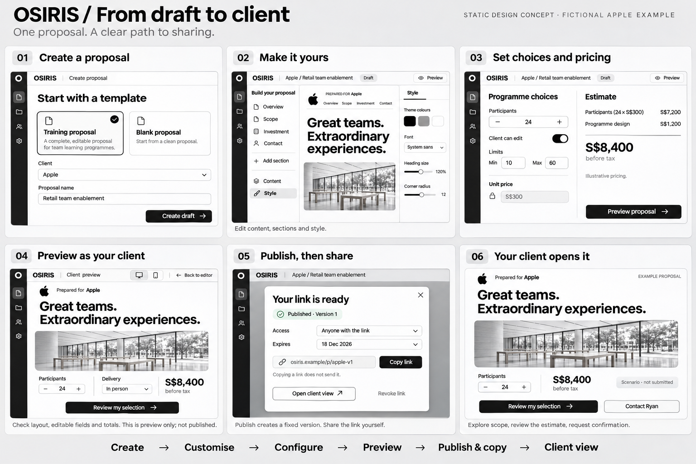
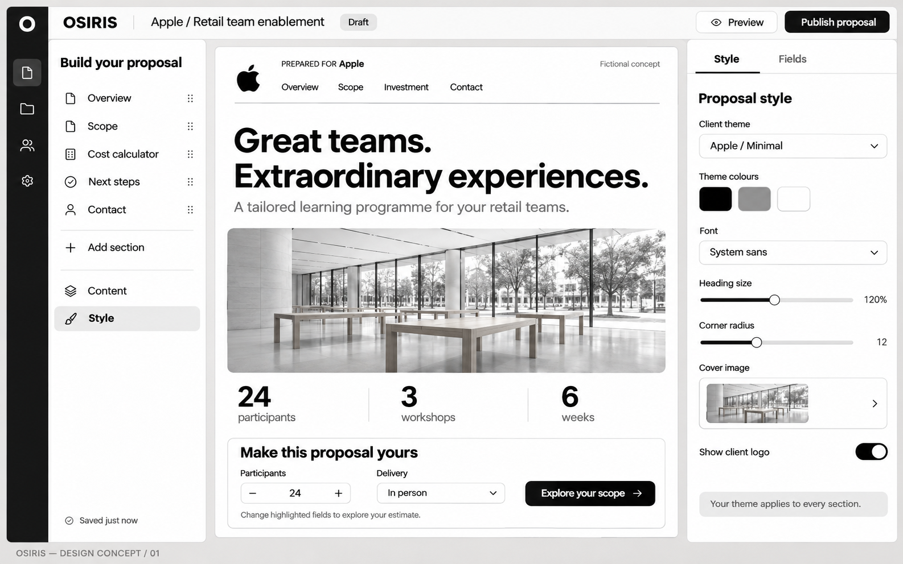
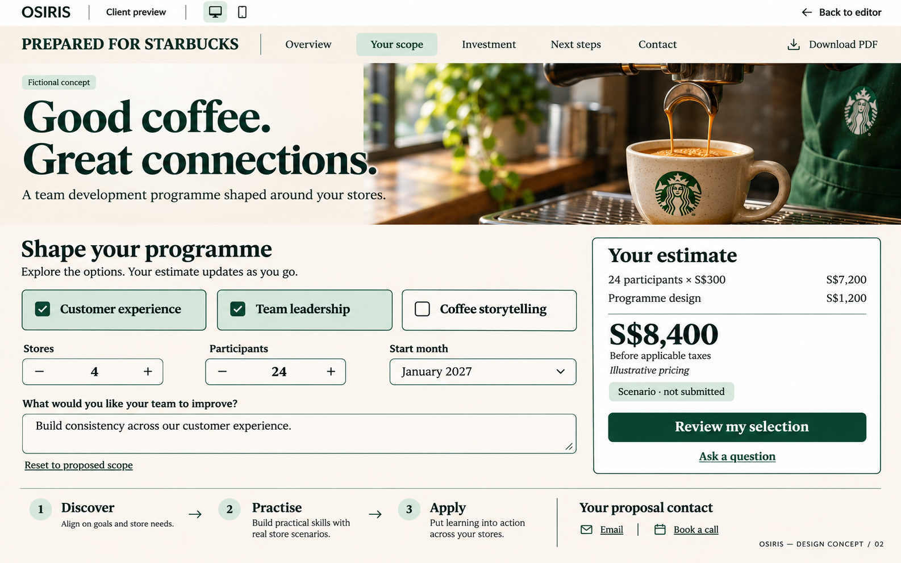
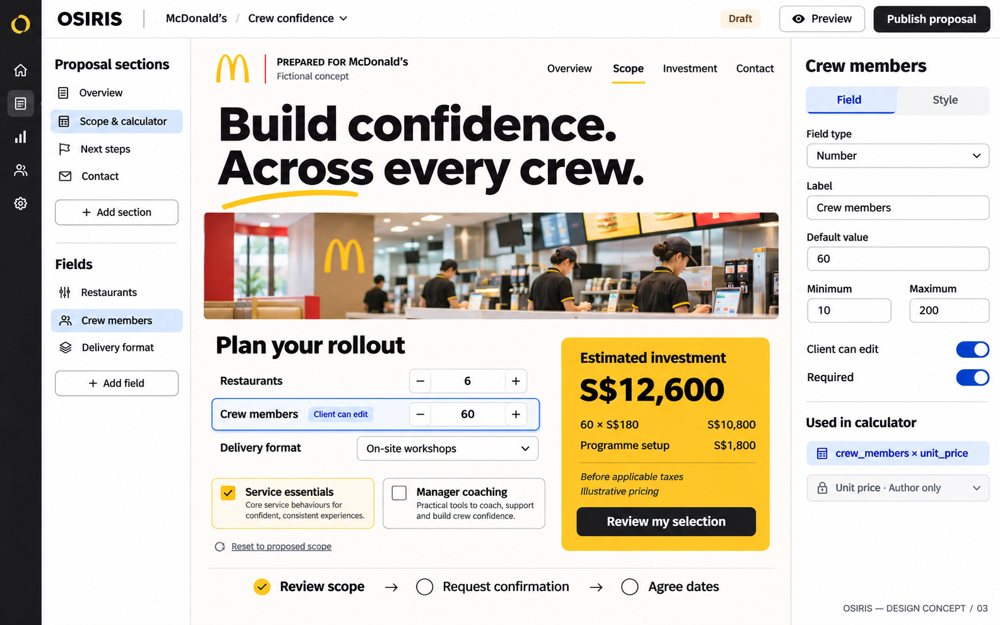

# OSIRIS

**Purpose-built interactive proposal builder for small teams and companies.**

Create a branded proposal, let recipients explore approved options, and turn their preferred scope into a clear next step.

> **Status: concept and planning only — 18 November 2026.** No application, dependencies, database, deployment, or working prototype has been created. Development requires a separate instruction from the project owner.

## The idea

OSIRIS brings a proposal's story, scope, pricing, questions, and contact options into one shareable experience. Start as a personal tool for creating and reusing proposals; expand to a small-team product only after the personal workflow proves useful.

The author controls the content, design, commercial rules, and which fields recipients can change. Recipients can explore quantities, options, delivery preferences, and goals without altering the original proposal. A review step makes it clear when an exploration becomes a submitted request.

## Planned capabilities

| Capability | What it enables |
| --- | --- |
| Style builder | Set logos, colour, typography, cover images, spacing, and section layouts with a live preview. |
| Proposal customisation | Add and reorder sections; reuse client information and templates. |
| Editable client fields | Add labelled text, number, date, choice, and checkbox fields with defaults, limits, and permissions. |
| Cost calculator | Connect permitted choices to an itemised estimate; show the original and current scenario clearly. |
| Scoping | Collect objectives, constraints, deliverables, team needs, and timing. |
| Call to action | Review a selection, request confirmation, request changes, or book a discussion. |
| Contact | Show a named proposal owner and configured email, phone, messaging, or booking links. |

## Concept visuals

These are static, AI-generated design explorations, not functioning screens. Apple, Starbucks, and McDonald's are fictional recipients used to demonstrate theme flexibility. They are not customers, partners, or endorsers. All programme descriptions and prices are invented examples.

### Main dashboard — Apple-layout direction

The preferred OSIRIS layout carries the Apple concept's monochrome shell into the personal workspace: a dark navigation rail, white panels, clear typography, and a single prominent creation action. Resume a draft, review a new client response, or manage published links from the same dashboard.

The sample dashboard contains three drafts, two published proposals, and one new response. These are fictional records. A response is a client request, not an accepted contract.

### From creating a proposal to sharing it

**Create → Customise → Configure → Preview → Publish and copy → Client view.**

1. Choose a template and enter the client and proposal name.
2. Edit the content, sections, and style in the Apple-inspired editor.
3. Define recipient-editable choices and connect them to author-controlled prices.
4. Preview the recipient experience and verify layout, inputs, and totals.
5. Publish a fixed revision, set access and expiry, then copy its link to share yourself.
6. The client opens a clean proposal, explores scope, and reviews a selection before requesting confirmation.

Publishing or copying a link does not send a message. The storyboard's `osiris.example` address is an illustrative placeholder, not a live application. [Detailed dashboard and flow specification](devplan.md#dashboard-and-create-to-share-concepts).

### Apple — author style builder

Minimal typography, monochrome imagery, and a live proposal preview beside theme controls.

### Starbucks — recipient scope and estimate

A warm editorial theme, adjustable programme options, and an itemised scenario summary. The top preview toolbar belongs to the author and would be absent from the recipient's shared link.

### McDonald's — editable-field builder

An author selects a field, permits client editing, sets bounds, and connects it to a controlled price rule.

The detailed plan takes precedence over incidental UI or typography differences in these generated images. System navigation, iconography, field styling, and accessibility still need design refinement.

## Planning documents

- [Development and design plan](devplan.md): reference investigation, user journeys, MVP scope, field permissions, calculation specification, architecture, acceptance criteria, roadmap, and startup validation.
- [Concept generation prompts](devplan.md#appendix-concept-generation-prompts): the exact prompt sets used with the built-in Imagegen tool, including the dashboard and create-to-share storyboard.

## Recommended first release

One owner, one workspace, reusable proposals, constrained theme presets, editable client fields, one currency per proposal, a reliable estimate, a private share link, recipient response capture, and a printable snapshot. Begin with training and consulting proposals; broaden templates after testing real use.

Team collaboration, subscriptions, CRM integration, payments, legally binding signatures, AI generation, and a template marketplace are later possibilities, not commitments for the first release.

## Reference and repository

- [Interactive proposal reference](https://sites.google.com/verticalinstitute.com/hebei-jinbiao-corp-training/hebei-jinbiao-construction-materials): inspected in the browser on 18 November 2026. The plan distinguishes observed recipient behaviour from inferred architecture and proposed OSIRIS features.
- [GitHub repository](https://github.com/Ryanx-ai/Osiris).

There are intentionally no install or run instructions yet.
