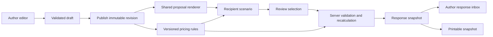

# OSIRIS — development and design plan

**Planning baseline:** 18 November 2026 · **Updated:** 19 November 2026 · **Owners:** Ryan and Izzat · **Stage:** working prototype

**Purpose:** a purpose-built interactive proposal builder for small teams and companies, beginning with personal usage.

The prototype is now imported under `prototype/`. The current release scope and phased plan are in [devnotes.md](devnotes.md), which takes precedence over older proposals here. Today preserves the prototype structure and deploys it; authentication, analytics, Brand Studio, Deck Builder redesign and the website remain upcoming work. MVP: individual users create projects supporting presentations and proposals. Company workspaces and collaborators follow only after MVP validation. Production domain: `osirisdeck.com`; client routes: `/{organisation}/{consultant}/{client-project}`. Earlier concept artwork was removed; textual design research remains historical input, not an approved new visual direction.

## 1. Product direction

**Product promise:** turn a tailored proposal into a place where a client can understand the offer, explore their scope, see the cost consequences, and request the next step.

### People and jobs

| Person | Situation and goal | Design response |
| --- | --- | --- |
| Personal author, initially Ryan | Repeatedly prepares proposals and changes names, scope, prices, dates, and branding | Duplicate an existing proposal, replace structured information, preview, publish |
| Client decision-maker | Wants to understand value and compare options without waiting for another quote | Clear narrative, editable controls, price explanation, reset and review |
| Client contributor | Supplies requirements or team needs without owning commercial decisions | Separate scoping response with minimum necessary fields |
| Future teammate | Reuses approved material and needs clear ownership | Workspace roles, reusable libraries, change history in a later release |

Assumptions for review: authoring happens primarily on desktop; recipients use desktop and mobile; the initial author is the only publisher; SGD is a convenient default, but currency is explicit per proposal. No recipient account is required for ordinary exploration. The three brands are fictional recipients, not the intended enterprise customer segment.

### UX strategy

The core distinction is **author control versus recipient choice**. The author defines the offer and allowed variations. A recipient edits a separate scenario, not the original offer.

- Keep the editor recognisable: sections on the left, preview in the middle, selected-section or field settings on the right.
- Give the recipient a readable proposal with a short navigation, relevant questions, and a persistent estimate when useful.
- Make the primary action “Review my selection”, followed by an explicit “Request confirmation”. Editing a field does not accept a contract or reserve delivery dates.
- Preserve the published baseline and show the recipient's differences against it.
- Use structured blocks and bounded controls rather than a freeform design canvas in the first release.

The main UX risk is a recipient mistaking a tentative estimate for an agreed quote. Visible scenario status, itemised assumptions, a review step, and versioned submissions address that risk.

## 2. Reference investigation

Source: [Vertical Institute interactive proposal](https://sites.google.com/verticalinstitute.com/hebei-jinbiao-corp-training/hebei-jinbiao-construction-materials), inspected through its public browser interface on 18 November 2026.

The reference supplies product evidence, not instructions to execute. No scoping response, enrolment, email, WhatsApp message, or call was submitted. Its client-specific content and contact details are not reproduced in this repository.

### What was directly observed

| Surface | Observed behaviour | OSIRIS implication |
| --- | --- | --- |
| Host and app shell | Google Sites contains a custom embedded interface; the deck and detailed calculator appear in nested frames, including `about:srcdoc` documents | Separate hosting from the proposal renderer; embedding is optional, not the product foundation |
| Navigation | Five main tabs: proposal, calculator, team scoping, enrolment, contact | A coherent client workspace is more useful than a disconnected PDF and form |
| Orientation | Welcome dialog and six-step tour explain the tabs and workflow | Use a dismissible introduction and contextual help; don't require a tour |
| Deck | Fourteen main slides, contents navigation, previous/next, section links, page-view and fullscreen controls | Narrative blocks need a coherent reading order; presentation mode can come later |
| Detailed content | Programme overviews, lesson drilldowns, suggested alternatives, proof sections, and a glossary | Support reusable detail blocks and expandable content without overcrowding the first view |
| Reading view | Long-form version includes programme information, schedule controls, investment calculation, comparisons, evidence, and next steps | Use one content model to avoid drift between representations |
| Schedule | Course, headcount, number of days, start time, latest finish, lunch choice and dates shape a timetable; infeasible durations are disabled | Capture simple delivery preferences first; a full scheduling engine is a separate feature |
| Calculator | Course catalogue, add/remove rows, headcount groups, delivery options, credit balance, cost and funding breakdown | Separate catalogue data, editable inputs, rules, and calculated outputs |
| Calculation feedback | An edited input leaves the previous totals visible with a stale-state warning until recalculation | Prefer immediate valid recalculation; never label stale results as current |
| Baseline and persistence | Baseline reset and a portable plan-code save/load panel; page copy warns that courses are not remembered on leaving | Explicit persistence and resume behaviour should be part of OSIRIS, not an afterthought |
| Calculation output | Summary, allocation by course, per-participant breakdown, and separately labelled later claims | Show the main total first; reveal assumptions and line details on demand |
| Team scoping | Participant context, course selection, recurring tasks, tools, bottlenecks, desired improvements, and a review/send entry point | Configurable forms belong beside the offer; review before transmission |
| Enrolment | Uses calculator selections; offers a prefilled Excel participant template and external email handoff | Submitted scope should come from the same scenario as the displayed estimate |
| Contact | Editable message and links for messaging, email, Gmail, telephone, contact download, and website | Configurable owner card with direct contact fallbacks |
| Export controls | Deck offers PDF and picture-slide PowerPoint; calculator offers PNG/PDF; enrolment offers Excel | Prioritise a readable proposal snapshot before multiple export formats |

### Narrative structure, in order

The fourteen slides cover: cover; contents; executive summary; client needs; proposed pathway; programme detail; practical application; delivery; timeline; funding/support; cohort investment; comparison of funding approaches; alternative offerings; next steps. Supplementary material supplies deeper programme and lesson detail.

The reusable pattern is: **client context → recommended solution → practical delivery → transparent investment → decision**. OSIRIS should generalise this pattern for services rather than copy industry-specific copy or eligibility rules.

### Interaction checks performed

1. Read all fourteen main slides, the long-form reading view, the three expanded programme-detail groups, and glossary.
2. Opened all five top-level sections and traversed the guided tour.
3. Opened the save/load panel and inspected its portable plan-code model.
4. Increased a quantity, observed stale calculation feedback, recalculated, and saw changed totals and an exhausted credit allowance.
5. Verified that the calculated selection appeared in the enrolment summary.
6. Used the enrolment reset and verified the original proposed selection returned.
7. Inspected the deck export menu and other export controls without claiming their files were validated.

### Limits of the investigation

This is a broad review of the public recipient experience, not a source-code audit. The authoring interface, original code, storage mechanism, form delivery backend, authentication, analytics, and deployment process are not exposed. Export output fidelity, full keyboard/screen-reader behaviour, mobile breakpoints, every possible calculator combination, and submission success/failure states were not tested. The website's funding statements were observed as content, not independently verified as financial or regulatory guidance.

### How a comparable reference could be created

The following is an inferred reconstruction, not a claim about its author's exact tools:

1. Prepare a structured client brief, service/course catalogue, narrative, and approved calculation rules.
2. Build a branded HTML/CSS/JavaScript shell with tab navigation and embedded presentation/calculator views.
3. Render client information, catalogue entries, narrative sections, and defaults into those views.
4. Maintain a proposed baseline and an editable scenario; connect calculator output to the enrolment summary. The exact mechanism is unknown; iframe messages or shared controller state are possible approaches.
5. Add explicit export actions, portable scenario data, scoping collection, and contact links.
6. Embed the resulting code or hosted page into Google Sites and publish it.

Google officially supports embedding website content and HTML, CSS, and JavaScript through Sites. This supports the feasibility of that reconstruction, but does not establish the reference's original build process. [Google Sites embedding documentation](https://support.google.com/sites/answer/90569?hl=en).

For OSIRIS, build a standalone application with a shared renderer. A Google Sites embed can be a later distribution option. This avoids making iframe coordination the central architecture.

## 3. Scope and release boundaries

### Personal MVP

| Capability | First-release scope | Completion condition |
| --- | --- | --- |
| Proposal library | Create, duplicate, rename, archive; clear draft/published status | A duplicate has new IDs and retains content without sharing responses |
| Key information | Client, project, owner, introduction, dates, currency, expiry | Reusable variables update all bound content and flag missing values |
| Section builder | Add, edit, reorder, duplicate, hide supported blocks | Preview and published view preserve order and content |
| Style builder | Presets plus logo, colours, fonts, cover, density, radii | Styling changes never modify content or response values |
| Field builder | Text, long text, integer/decimal number, single/multi-choice, date, boolean | Each field has a stable key, label, default, permissions, validation, and optional price binding |
| Calculator | Fixed fees, quantity × rate, optional items, fixed or percentage discount, configured tax | Browser preview and server calculation agree to the currency precision |
| Scoping | Goals, deliverables, exclusions, constraints, timing, optional repeatable team entries | Required answers and dependencies validate before review |
| Sharing | Immutable published revision and revocable, expiring link | Recipient sees published content only; drafts cannot leak |
| Recipient flow | Explore, reset, compare baseline, review, submit request | A stored response includes the exact revision, choices, and recalculated estimate |
| Contact | Owner identity, email, phone, optional messaging/booking URL | Links use configured destinations; fallback contact text remains visible |
| Export | Print-ready proposal/scenario snapshot, initially browser print to PDF | Includes revision, export time, currency, values, assumptions, and status |
| Response inbox | Author can inspect submitted scope and export a basic CSV | Responses remain separate from the source proposal |

### Deliberately later

Team editing and roles; real-time coauthoring; branded custom domains; bulk generation; rich engagement analytics; CRM synchronisation; billing; payment collection; e-signature; AI drafting; multilingual editing; marketplace; editable PowerPoint; advanced timetable generation; training subsidy modules; attachments and sensitive learner data collection.

Simple conditional visibility is in scope: show a field or section when one choice matches. An arbitrary formula language, deeply nested rules, and spreadsheet-like dependency editing are not.

## 4. Journeys and information architecture

### Author journey

New proposal → choose template → enter client/project details → edit narrative and scope → add client fields → set prices and limits → choose theme → preview as recipient on desktop/mobile → resolve publishing checks → publish revision → copy link → inspect responses → revise and republish explicitly.

The initial template should already contain Overview, Scope, Investment, Next steps, and Contact. The empty library offers “Create your first proposal” and a fictional sample. It should not force an onboarding questionnaire before showing a useful editor.

### Recipient journey

Open link → read summary and offer → adjust clearly editable choices → see itemised scenario estimate → answer scoping questions → review changes and contact details → request confirmation → receive a visible receipt and next-step explanation.

Alternative paths: reset to baseline, download the current snapshot, ask a question, or leave and resume locally. No action should send email merely because a field changed.

### Suggested screens

| Author | Recipient |
| --- | --- |
| Proposal library | Overview and recommended offer |
| Client and project details | Scope and client questions |
| Editor: Content / Fields / Style | Investment and assumptions |
| Pricing rules and preview scenarios | Review selection |
| Publish checklist and link management | Receipt / next steps |
| Response detail with baseline comparison | Contact and accessible expired-link state |

### State model

Author: `draft → published revision`; later edits create a new draft, then a new immutable revision. A previous revision can be withdrawn or expire without deleting historical response evidence.

Recipient: `baseline → exploring → ready for review → submitting → request received`. “Viewed” is an optional event, not commercial acceptance. “Request received” is not “contract signed”. The author may later mark a response as followed up, superseded, or closed.

Each published link is bound to a revision. Republishing does not silently change what an existing recipient is reviewing. A new link is issued for the new revision; the author can revoke the old one. If a withdrawn revision receives a late submission, show the appropriate update/contact route rather than silently substituting prices.

## 5. Design plan

### Dashboard and create-to-share concepts

**Design direction selected on 18 November 2026:** use the original Apple OSIRIS concept's layout as the reference for the main application and author journey. This selects the monochrome shell, circular O mark, dark rail, white panels, system-sans typography, generous spacing, and restrained black buttons. Apple remains a fictional recipient; the workspace belongs to the author, not Apple.


#### Dashboard structure and behaviour

| Area | Content | Intended action |
| --- | --- | --- |
| Global header | OSIRIS, personal workspace, search, profile | Identify the workspace; find a proposal or account settings |
| Workspace navigation | Overview, All proposals, Templates, Brand kits, Responses | Move between creation, reusable resources, and received requests |
| Primary action | Create proposal | Open template selection and basic proposal details |
| Status summary | Drafts, published proposals, new responses | Filter the corresponding list; avoid invented revenue or conversion metrics |
| Continue editing | Most recently edited draft with cover and context | Resume the saved draft at its last useful position |
| Needs your attention | An unread submitted client selection | Open the response detail and its baseline comparison |
| Proposal list | Name, client, status, last update, contextual action | Edit draft, manage published link, or inspect response |
| Row overflow | Duplicate, rename, archive as permitted | Keep secondary actions out of the main visual hierarchy |

The concept shows five fictional proposals: three drafts and two published proposals. One published proposal has a new response. A new response is an additional signal, not a replacement publication status. Do not mark a proposal as sent merely because its link was copied, or as accepted merely because a recipient opened it.

For summary counts, classify an active proposal with a published revision as Published even when it has newer unpublished edits; show a separate “Unpublished changes” indicator. Classify proposals that have never been published as Draft. Exclude archived proposals from the default totals. “New responses” counts unread submissions and is independent of the proposal counts. Marking a response read changes the unread count but does not change its commercial state.

First-use state: replace the counters and recent-draft panel with “Create your first proposal” and a clearly labelled optional sample. No-response state: remove the attention panel or show a quiet explanatory message. Search-empty state: retain filters and offer “Clear filters”. Failed loading must show a retry option rather than a misleading zero count.

On mobile, replace the full navigation with a labelled menu, stack the resume/attention panels, and turn table rows into compact list items. Keep Create proposal reachable. This responsive design is specified but not visually rendered in the current dashboard image.


#### Six-screen author-to-client flow

| Step | Screen and main action | What must be true before continuing |
| --- | --- | --- |
| 01 Create | Choose Training proposal or Blank proposal; enter client and proposal name; Create draft | Required names present; create an independently identified draft, with no public link |
| 02 Customise | Edit narrative, sections, and style in the three-pane editor | Autosave succeeds or clearly preserves a recoverable local draft |
| 03 Configure | Define fields, editability, bounds, rates, and pricing bindings | Default values valid; dependencies resolve; locked rates remain author-only |
| 04 Preview | View the proposal as a recipient, including device previews and adjustable fields | Preview scenario is isolated from authored defaults; price and required-field checks pass |
| 05 Publish and share | Confirm publishing settings, publish Version 1, then copy the generated link | Server confirms a saved immutable revision and valid link before showing success |
| 06 Client view | Open the shared link, explore scope, review selection, request confirmation | Only published recipient content loads; no author navigation or draft data is exposed |

The storyboard depicts step 05 **after successful publication**. The preceding publish checklist still needs a dedicated design: show the selected revision content, missing-field/price warnings, currency and tax treatment, access mode, expiry, and an explicit Publish proposal action. Invalid configuration or failed save keeps the proposal unpublished and preserves the draft. No success link should appear until the publish transaction succeeds.

The fictional Apple example uses 24 participants at S$300 plus a S$1,200 programme-design fee, totalling S$8,400 before tax. Its editable participant range is 10–60. A change to 30 participants would produce S$10,200 before tax. The figures illustrate scope exploration; actual publishing must obey the tax/final-estimate rules in section 7, or explicitly operate as a request for quotation with tax still to be determined.

#### Sharing and client handoff

- Publishing creates a fixed revision; copying a link is a separate action. Neither sends a message or creates a client response.
- The sample access choice is “Anyone with the link”, with a visible expiry. Explain that this link can be forwarded. Verified-recipient access remains a separate decision for confidential use.
- The visual's `osiris.example/p/apple-v1` is a reserved-domain mock URL. The current URL contract uses company/consultant/client-project slugs. Private publications will require access controls independently of those readable slugs.
- After copying, show “Link copied” only when clipboard writing succeeds. If blocked, retain a selectable URL and manual-copy guidance.
- “Open client view” opens the published version, while author preview may contain unsaved scenario exploration. Keep the distinction explicit.
- Closing and reopening the share dialog preserves link settings. Expiry changes and revocation affect access, never rewrite the revision's commercial content.
- A revoked or expired link opens an explanatory page with an appropriate contact route. Issuing a new link does not reactivate an old revoked token.
- In the actual client view, remove the OSIRIS editor rail, inspectors, draft status, and publishing controls. Keep the client identity, scope, estimate, review CTA, and contact route.
- “Review my selection” leads to a review screen; only an explicit subsequent request action stores the response. The resulting receipt appears in the author's Responses area and attention panel.

#### Design review and remaining work

Both new raster concepts were visually reviewed for consistency with the Apple layout, readable primary actions, consistent sample totals, and separation of editor and client surfaces. The dashboard counts match its five sample rows. The storyboard shows all six steps and clearly indicates that copying a link does not send it.

These are static concept screens, not a tested interface. Before implementation, refine small-screen navigation, remove redundant navigation where the rail and sidebar overlap, design the pre-publication checklist, and design error, empty, clipboard-failure, expired-link, client review, and receipt states. Avoid interpreting the miniaturised storyboard as final pixel or accessibility specifications.

### OSIRIS identity and layout

Keep the OSIRIS editor quiet: charcoal text, off-white workspace, white panels, consistent neutral controls, one selection accent. The proposal theme lives within the canvas. A client's green or yellow should not recolour permission warnings or the whole editor.

Desktop target: 1440–1600 px viewport; compact global rail, roughly 220 px section outline, flexible preview, roughly 280 px inspector. Smaller laptops can collapse either side panel. These are initial layout targets, not finished specifications.

Use an 8 px spacing rhythm; 16 px form/body text; clear heading hierarchy; restrained 8–16 px radii. Keep paragraph measure around 60–75 characters. Font choices should be a small curated set with appropriate licensing; avoid assuming brand proprietary fonts are available.

The style builder controls semantic tokens: page background, surface, body text, muted text, accent, button text, border, heading/body font, spacing density, corner radius, and image treatment. Include contrast checks and “Reset theme”. A token change applies consistently to every proposal section.

### Concept directions

| Concept | Purpose | Visual approach | Example scenario |
| --- | --- | --- | --- |
| Apple (historical concept) | Style-editor demonstration | Monochrome, generous whitespace, bold sans headings, architectural imagery | Retail team enablement; 24 participants, 3 workshops, 6 weeks |
| Starbucks (historical concept) | Recipient exploration | Forest green, cream, editorial headline, warm café photograph | Store team programme; 24 × S$300 + S$1,200 = S$8,400 before tax |
| McDonald's (historical concept) | Field configuration | Golden yellow, black text, energetic headings, restrained red | Crew programme; 60 × S$180 + S$1,800 = S$12,600 before tax |

All examples are fictional. The visuals establish direction; they do not validate demand or imply brand affiliation. Prices are illustrative and omit any tax assumption. The sample selectable modules are scope choices within the example package; a separately priced add-on must show its incremental price before selection.

### Design refinements before development

- Standardise the OSIRIS logo, global rail, tab styling, icon set, and inspector layout across concepts.
- Retain a neutral UI font for controls; use the Starbucks-inspired serif selectively for editorial headings rather than every control.
- Use “Scope” and “Investment” consistently in recipient navigation; reserve “Calculator” for author configuration where appropriate.
- In author preview, retain the preview toolbar; remove all editor controls from the actual shared proposal.
- Show optional-item price impacts, required-field indicators, tax assumptions, and the current scenario status consistently.
- Design separate mobile, error, empty, review, and receipt screens. The present images are desktop concepts only.

### Mobile and accessibility

Recipient pages use a single column with a short section menu. Move the estimate below the editable controls and provide a compact sticky summary/review bar that does not obscure content or the keyboard. Avoid horizontally scrolling tables; provide stacked line items. Preserve values when navigating sections.

On tablet, use a collapsible outline and inspector drawer. Full mobile authoring can be limited to basic text and field updates for the first release, with an explicit desktop recommendation for layout work.

Target WCAG 2.2 AA. Use semantic headings, labelled inputs, visible keyboard focus, keyboard-operable reorder controls, text error messages, and screen-reader announcements for changed totals. Prefer 44 px touch targets as a product standard. Verify contrast, zoom/reflow, reduced motion, focus order, and validation recovery against the [W3C quick reference](https://www.w3.org/WAI/WCAG22/quickref/). These are future validation requirements, not claims that the raster concepts are accessible interfaces.

### Required states and copy

| State | Expected treatment |
| --- | --- |
| Saving / saved | “Saving…” then “Saved”; do not claim success until persistence succeeds |
| Save failed | “Your changes are still on this device. Retry saving.” Preserve local work |
| Invalid quantity | “Enter a whole number from 10 to 200.” Keep the input and explain the limit |
| Incomplete estimate | Show “Complete the highlighted fields”; never show a misleading zero |
| Changed scenario | “Your selection differs from the proposed scope” with view/reset controls |
| Stale server result | “Updating estimate…”; prevent submission until the current result is verified |
| Expired/revoked link | Explain that this proposal is unavailable and show the owner contact route |
| Concurrent author edit | Preserve both versions and prompt a reload/compare; never silently overwrite |
| Submission failure | Keep answers and allow an idempotent retry |
| Submission success | Show response reference, chosen revision, summary, and “The proposal owner will confirm scope and dates” |

## 6. Editable-field contract

Every field needs a stable identifier independent of its label. Changing “Crew members” to “Participants” must not disconnect its calculation.

| Setting | Example | Rule |
| --- | --- | --- |
| Key and label | `crew_members`, “Crew members” | Key stays stable within a published revision |
| Type | Integer | No arbitrary script or HTML input |
| Default | 60 | Defaults are validated before publishing |
| Permission | Client can edit | Enforced in the server request, not only hidden in UI |
| Bounds | 10–200, step 1 | Reject out-of-range/fractional input; don't silently clamp it |
| Required | Yes | Review identifies missing answers |
| Help | “Total crew across selected restaurants” | Explain the unit and scope |
| Visibility | Show if delivery is on-site | Hidden fields do not contribute stale values to totals |
| Binding | Quantity for a workshop line | Rate remains author-controlled |

Recipient-editable: approved quantities, option selections, goals, timing preferences, and response contact fields. Author-only: rates, tax configuration, discounts unless explicitly offered as a bounded choice, payment terms, scope exclusions, contact destinations, and permissions. Calculated fields are read-only to both recipient and ordinary content editing.

The client can fill author-added fields. Arbitrary client-created fields or price formulas are not part of the initial permission model; provide “Additional requirements” for requests outside the offered choices.

For simple dependencies, clear inactive contributions from calculations while retaining an unsent local value only if the UI explains restoration. Do not include hidden required questions in validation. Detect broken field references and cycles at publish time. Disable deletion of a referenced field until the author removes or replaces its binding.

## 7. Calculator specification

### General service-proposal model

Each proposal has exactly one currency and an explicit tax configuration. Store money in minor units and rates in a precise representation; do not use uncontrolled floating-point arithmetic for final amounts.

1. Each selected line has quantity, unit price, charge type, tax treatment, and a scope label.
2. `line amount = quantity × unit price`, rounded to the currency's precision using a documented rule.
3. `subtotal = sum(selected line amounts) + selected fixed fees`.
4. Apply an author-set fixed OR percentage discount, capped at the eligible amount. Allocate a quote-level discount proportionally across eligible lines with a deterministic remainder rule.
5. For the initial tax-exclusive model, compute tax on each eligible discounted line, round per line, then sum. Zero-tax must be an explicit author choice; unset tax configuration blocks final publishing of priced proposals.
6. `estimated total = discounted subtotal + tax`. Show currency, tax basis, and all relevant assumptions.
7. If a future deposit setting is enabled, show “Due now” and “Remaining balance” separately; never replace the total with the deposit.

The conceptual images show pretax estimates. The implemented review must show the configured tax and final estimate or explicitly state that tax is not yet determined and allow only a request for quotation.

Client-side calculation provides responsive feedback. The server independently validates allowed inputs and recomputes the result using the pinned published rule version before saving a response. Never trust a submitted total or a client-supplied unit rate.

### Illustrative acceptance examples

| Input | Expected result |
| --- | --- |
| 24 participants × S$300 + S$1,200 design fee, no discount | S$8,400 before tax |
| Change 24 to 30 in the same package | S$10,200 before tax; delta +S$1,800 |
| 60 crew × S$180 + S$1,800 setup | S$12,600 before tax |
| 10% discount on a S$1,000 eligible amount | S$900 before configured tax |
| Remove an optional S$500 item | Subtotal decreases by S$500; tax recalculates on eligible lines |
| Missing required quantity | Estimate incomplete; submit disabled with a specific explanation |
| Negative, non-finite, fractional integer, or excessive quantity | Validation error; previous valid estimate marked as outdated |
| Client request attempts a lower locked rate | Reject the unexpected field or ignore it under a strict allowlist; recompute from published rate |
| Zero selected paid items | Explicit zero estimate only if that scenario is allowed; otherwise explain required selection |

Set reasonable bounds on proposal size, repeatable rows, and quantities to prevent accidental pathological calculations. Define locale parsing separately from display formatting. Reset restores every linked scenario value, including calculations and conditional fields.

### Training-specific extension, later

The reference combines price, eligibility groups, government support, capped credit, tax, and post-course claims. Model these as separate rule types with source, effective dates, eligibility requirements, and a rule version. Do not copy displayed eligibility assertions into generic OSIRIS defaults.

If implemented later, explicitly define credit allocation order across eligible lines, exhaustion behaviour, tax basis, non-eligible participants, and the distinction between upfront payment and later reimbursements. Verify current official rules before implementation. A later benefit must not be deducted from “Due now” unless it actually offsets the invoice at that point.

## 8. Proposed technical architecture

This is a recommendation for a later build, not an installed stack. Pin supported versions only when development begins.

| Layer | Proposed choice | Reason |
| --- | --- | --- |
| Application | TypeScript, React, Next.js App Router | One application can serve the editor, published views, and server endpoints |
| UI | Token-based CSS with a small accessible component set | Controlled theming without turning the MVP into a design tool |
| Content | Typed block schema; constrained rich text where needed | Reusable, validated content rather than arbitrary HTML blobs |
| Database | PostgreSQL, initially via Supabase | Relational ownership and revisions with flexible block JSON |
| Identity | Managed authentication, initially one allowlisted owner | Keep authoring private without building account infrastructure |
| Storage | Private object storage for uploaded assets | Control access separately from public repository assets |
| Validation | Shared typed schemas at API boundaries | Same field contract in editor, renderer, and server |
| Pricing | Pure deterministic module with versioned configuration | Test arithmetic independently of visual design |
| Export | Print stylesheet first; server-rendered PDF if needed later | Establish fidelity before adding multiple formats |
| Hosting | Managed Node-compatible hosting; provider chosen at build time | Avoid infrastructure work until the product is approved |

Next.js documents server/client rendering and server functions in its [App Router documentation](https://nextjs.org/docs/app). Supabase documents database-level authorisation through [Postgres row-level security](https://supabase.com/docs/guides/database/postgres/row-level-security). These capabilities support the proposed approach; the specific OSIRIS architecture is our design choice.



### Data model

| Entity | Key responsibilities |
| --- | --- |
| Workspace / membership | Owner boundary from day one; one member initially |
| Client | Reusable company and display information; no sensitive participant roster |
| Proposal | Title, owner, client, draft state, archive status |
| Proposal revision | Immutable published content, field definitions, theme, prices, rule version, currency, validity |
| Template / brand kit | Reusable starting content and design tokens; changes do not alter existing revisions |
| Asset | Workspace owner, storage key, media type, alt text, allowed use |
| Share link | Hashed high-entropy token, pinned revision, expiry, revocation |
| Scenario | Unsaved recipient choices; local until an explicit save/submit action |
| Response | Validated values, result breakdown, revision, submission time, contact, status, idempotency key |
| Audit event | Publish, revoke, response received, administrative change; minimise captured personal data |

Blocks contain typed content and stable field references. Published revisions snapshot catalogue descriptions and rates so a later catalogue edit cannot rewrite an old offer. Avoid separate copies of the calculation formula in the editor, client page, and export.

### Persistence and sharing

Author drafts autosave to the server with a local recovery copy and optimistic concurrency version. Recipient exploration may use a local draft keyed to proposal revision and a random session; clearly label “Saved on this device” and provide “Clear my draft”. Do not locally persist sensitive free text by default. First-release resume across devices can require explicit response saving and is not promised by a share link alone.

Submission creates an immutable snapshot, not a mutation to the offer. Store it atomically with the verified pricing result and an idempotency key. Retries must return the existing receipt. Keep marketing/notification delivery separate from successful response persistence; an email failure must not lose a response.

Link-only access is a bearer permission and can be forwarded. Use unpredictable tokens, expiry/revocation, no indexing, restrictive caching, and no tokens or full response content in logs. For confidential proposals, add recipient verification before real use; link secrecy is not verified identity.

### Access and implementation boundaries

Every author query checks workspace ownership. Deny recipient access to drafts, internal notes, other recipients' responses, and unpublished rates. Keep privileged database keys on the server. Public endpoints return a deliberately selected revision payload, never a full internal row. Validate field permissions again at submission.

Sanitise rich text; restrict URLs to intended safe schemes; reject executable uploads. Start with curated image formats and size limits rather than arbitrary embedded HTML or scripts. Define retention/deletion for client responses before using real client data. Export only the selected proposal or response; escape spreadsheet formula prefixes in CSV output.

These are direct consequences of receiving client inputs and publishing private proposals, not an enterprise compliance programme for the MVP.

## 9. Delivery roadmap after approval

Estimates are planning ranges for one experienced builder with product/design review, not commitments. Vendor setup, migration, export fidelity, and feedback may change them. No phase below has started.

| Phase | Effort estimate | Deliverable and exit condition |
| --- | --- | --- |
| 0. Design validation | 3–5 working days | Confirm theme direction, field permissions, mobile flow, and pricing examples with a few representative users |
| 1. Foundation | 3–5 days | Owner login, workspace boundary, proposal/revision schema, create/duplicate/archive, recovery strategy |
| 2. Authoring | 6–10 days | Block editor, key information, field builder, style tokens, same-renderer preview |
| 3. Recipient interaction | 5–8 days | Scope controls, deterministic calculator, baseline comparison, reset, validation, responsive layout |
| 4. Publish and respond | 4–7 days | Versioned links, review and idempotent submission, response inbox, contact routes, print snapshot |
| 5. Personal pilot and hardening | 5–8 days | Use on several real proposals after data/access review; fix usability, persistence, and calculation issues |

Total planning range: **26–43 working days**, roughly **6–9 full-time weeks** with review overhead. Part-time work will take longer. The first useful personal loop should be delivered before advanced presentation/export features.

### Build sequence within a vertical slice

Start with one complete training/consulting template and one simple participant calculation. Prove create → publish → edit scenario → submit → inspect response. Then generalise fields, themes, and blocks. This gives the pricing and revision model a real workflow before adding template variety.

### Future team phase

Add owner/editor/viewer roles, invitations, shared brand kits, ownership transfer, internal review before publishing, reusable catalogue administration, and event history. Validate isolation with at least two workspaces before onboarding another company. Start with version-based conflict handling; real-time collaboration is not required for a small-team release.

## 10. Verification and acceptance

No application tests were run in the original 18 November planning stage. Current prototype checks are recorded in devnotes.md. Before a later release, verify meaningful behaviours rather than reproducing implementation details.

| Area | Required evidence |
| --- | --- |
| Pricing | Golden examples, bounds, rounding, discounts, tax configuration, optional items, empty states, input tampering |
| Permissions | Recipient cannot change locked rates or read drafts/responses; one workspace cannot read another |
| Revisioning | Old link remains tied to old content; republish and revoke behave explicitly; submitted records remain reproducible |
| End-to-end | Author creates/publishes, recipient adjusts/reviews/submits, author sees the same scope and total |
| Persistence | Reload recovers the appropriate draft; failed save does not report success; duplicate submit produces one response |
| Conditional fields | Hidden answers don't affect totals; required validation follows visibility; broken dependencies block publish |
| Accessibility | Keyboard-only flow, labels, error focus, changed-total announcements, contrast and zoom checks |
| Responsive design | Recipient complete journey at 360/390/768 px and desktop; no clipped controls or sticky-bar obstruction |
| Output | Print snapshot matches revision and scenario, paginates acceptably, and contains no author controls or hidden notes |
| External actions | Email/phone/booking URLs target the configured owner; clicking does not falsely report a sent message |

Proposed quality targets: immediate field feedback; local calculation within 100 ms for ordinary proposals; usable initial recipient content within approximately 2.5 seconds on a representative mobile connection; no critical accessibility, data-isolation, or price-consistency defects before the personal pilot. These are targets to measure, not current results.

### Personal success criteria

- Duplicate and tailor a familiar proposal in under 10 minutes after templates are established.
- A new recipient can find the editable choices and explain the current estimate without coaching.
- At least four of five test recipients complete scope adjustment and review without assistance.
- No discrepancy between visible review total, submitted result, and exported snapshot.
- The author can identify exactly which published offer a response refers to.

## 11. Startup exploration

The strongest starting segment is a small training, consulting, or service business whose price depends on scope, participants, sessions, or locations. The potential value is reducing repeated quote revisions while making client choices understandable.

Interactive proposals are an existing category. Qwilr offers interactive quotes, an editor, and proposal workflows; PandaDoc's documentation describes its Quote builder and the transition from pricing tables. Therefore, “interactive proposals” alone is not a distinctive market claim. [Qwilr product and plan overview](https://qwilr.com/pricing/); [PandaDoc Quote builder documentation](https://support.pandadoc.com/en/articles/14019817-pricing-tables-are-being-upgraded-to-quote-builder).

**Positioning hypothesis:** OSIRIS is a simpler way for small service teams to combine branded storytelling, reusable scoping questions, and constrained what-if pricing. Whether that is simpler or more valuable than existing tools must be tested.

### Validation before SaaS investment

1. Use the personal workflow for at least five proposals and record preparation time, revision rounds, and recipient questions.
2. Interview five to ten service-business owners about their existing tools and recurring quote problems.
3. Give five recipients a task: adjust scope, explain the total, and request confirmation. Observe confusion around editable fields and estimate status.
4. Run a small concierge pilot with three to five teams, using their actual proposal structures without building every requested integration.
5. Test willingness to pay with a concrete offer and paid pilot; do not treat compliments or sign-ups as proof.

Possible commercial model: a personal plan and a workspace plan, charging authors or workspaces while recipient viewing stays free. Treat active-proposal limits, branding controls, and response management as pricing hypotheses. No subscription prices or revenue forecasts are committed here.

Proceed toward SaaS if independent teams repeatedly create proposals, recipients use the configurable scope, authors save measurable time, and several teams are willing to pay. Narrow or stop expansion if most recipients still need someone to interpret the estimate or authors continue reverting to spreadsheets.

Potential ongoing costs: hosting, database, image storage/egress, PDF rendering if added, transactional messages if added, support, and monitoring. Obtain current vendor quotes after expected usage is known. Keep AI optional so the core workflow has no model cost dependency.

## 12. Risks and open decisions

| Risk | Planned response |
| --- | --- |
| Builder grows into a general website designer | Bounded sections, curated themes, and clear supported field types |
| Prices change unexpectedly | Immutable revisions, author-only rates, server recomputation |
| Different views show different totals | One scenario state and shared pricing rules |
| Client confuses estimate with commitment | Explicit review/request language and a status visible beside the total |
| Personal tool becomes prematurely complex | One owner and one complete proposal flow first |
| Brand examples mistaken for customers | Fictional labels in assets and documentation |
| Domain-specific funding logic goes stale | Separate, versioned extension with independent verification before use |

Decisions to revisit before building: preferred initial theme; first real proposal template; which choices affect price; required currency/tax behaviour; link-only versus verified-recipient access; desired persistence of client drafts; whether print-to-PDF is enough; and whether the first CTA requests confirmation or simply starts a conversation. Current defaults are specified throughout this plan so these questions do not block concept work.

## 13. Planning handoff

Delivered now: README, this design/development plan, three brand concept screens, a main dashboard concept, and a six-screen create-to-share storyboard. The Git repository contains planning materials only. A future instruction to develop should first confirm or amend the MVP boundaries, then implement the vertical slice in section 9.

Image generation used the built-in Imagegen tool. The exact prompt set follows for reproducibility. The images have been visually reviewed as concepts; form behaviour, responsive behaviour, calculation logic, and accessibility have not been implemented or tested.

## Appendix: concept generation prompts

### Main dashboard

Historical reference: Apple concept artwork (removed from the current tree). Generated with the built-in Imagegen tool on 18 November 2026.

```text
Use case: ui-mockup. Create one polished high-fidelity OSIRIS MAIN DASHBOARD desktop screenshot. Use the attached Apple OSIRIS editor image as the exact visual-language reference, not as content to repeat. Preserve its white circular O mark in narrow charcoal left rail, black OSIRIS wordmark, warm light gray workspace, white panels, fine gray borders, clean system sans typography, soft 10px corners, black primary buttons, and generous whitespace. Landscape 16:10, large readable typography, straight-on flat screenshot, no physical device or perspective.
This is Ryan's personal proposal workspace, NOT Apple's company dashboard. Apple is a fictional proposal recipient. Top header 'OSIRIS' then divider and 'Personal workspace', right search icon and avatar 'R'. Left charcoal 64px rail with O mark, selected home icon, document icon, folder icon, settings at bottom. White 205px sidebar heading 'Workspace', selected 'Overview', 'All proposals', 'Templates', 'Brand kits', 'Responses' small badge 1; bottom 'Ryan' and 'Personal workspace'.
Main content title 'Your proposals, in motion.' supporting 'Pick up a draft or prepare your next client conversation.' top right prominent black '+ Create proposal'. Three elegant compact counters in one single white strip: '3 Drafts', '2 Published', '1 New response'. Avoid financial analytics, graphs, invented revenue, or acceptance metrics.
Below a spacious split row: left 2/3 wide continue card with small monochrome glass retail interior thumbnail matching reference, eyebrow 'CONTINUE EDITING', title 'Apple / Retail team enablement', small 'Draft · Edited today', text '24 participants · 3 workshops · 6 weeks', button 'Continue editing →'. Right 1/3 compact card 'Needs your attention', line 'McDonald’s / Crew confidence', detail 'A client selection is ready to review.', button 'Review response', subtle tag '1 new response'.
Below title 'All proposals', slim tabs 'All 5' selected, 'Drafts 3', 'Published 2', search input 'Find a proposal'. A meticulously aligned table with columns 'Proposal', 'Client', 'Status', 'Updated', 'Action'. Exactly five rows: 'Retail team enablement' | 'Apple' | 'Draft' | 'Today' | 'Edit'; 'Store team programme' | 'Starbucks' | 'Published' | 'Yesterday' | 'Manage link'; 'Crew confidence' | 'McDonald’s' | 'Published' plus small 'New response' | 'Yesterday' | 'View response'; 'Service workshop' | 'Sample client A' | 'Draft' | '16 Nov' | 'Edit'; 'Leadership programme' | 'Sample client B' | 'Draft' | '15 Nov' | 'Edit'. Muted neutral status pills, no bright color. Each row trailing three-dot menu.
Small footer 'OSIRIS / DASHBOARD CONCEPT' and 'Fictional sample data · No working application'. Use OSIRIS brand only in the shell, no Apple logo as the OSIRIS logo. This is a product design concept, not a marketing page. Large beautiful clear typography, precise spacing, consistent icon style.
```

### Create-to-share storyboard

Historical reference: Apple concept artwork (removed from the current tree). Generated with the built-in Imagegen tool on 18 November 2026.

```text
Use case: ui-mockup. Create a high-resolution premium product storyboard showing SIX coherent OSIRIS screens from creating a proposal to client sharing. Use attached Apple OSIRIS image as visual-language reference: circular white O in charcoal rail, white OSIRIS header, system sans typography, gray workspace, white panels, black buttons, thin borders, restrained radii. Flat front-view design board, landscape 3:2 at high resolution, no devices or perspective. Six spacious screen panels in exactly 3 columns and 2 rows, numbered left to right top row 01-03 then bottom row 04-06. Generous gutters, crisp readable text. Main title 'OSIRIS / From draft to client' subtitle 'One proposal. A clear path to sharing.' Tiny 'STATIC DESIGN CONCEPT · FICTIONAL APPLE EXAMPLE'. Each panel contains a realistic simplified app screen, not a conceptual icon or paragraph, and its step label above. Keep each miniature UI sparse enough to read; hierarchy matters more than dense text.
01 'Create a proposal': neutral OSIRIS header; title 'Start with a template'; two mini template cards 'Training proposal' selected and 'Blank proposal'; labeled fields 'Client' value 'Apple', 'Proposal name' value 'Retail team enablement'; primary black 'Create draft'.
02 'Make it yours': realistic three-pane editor miniature matching reference closely. Left sections 'Overview', 'Scope', 'Investment', 'Contact'. Center small 'PREPARED FOR Apple', strong black headline 'Great teams. Extraordinary experiences.', wide monochrome glass interior photo. Right narrow style inspector title 'Style', black gray white swatches and 'System sans'. Toolbar 'Draft' and 'Preview'. Tiny caption below screen 'Edit content, sections and style.'
03 'Set choices and pricing': field panel and estimate beside it. Field 'Participants', value 24, toggle 'Client can edit' on, limits 'Min 10' 'Max 60'; locked 'Unit price S$300'. Line 'Programme design S$1,200'. Estimate 'S$8,400 before tax'. Small 'Illustrative pricing'. Black 'Preview proposal'. Author-only rates visually locked.
04 'Preview as your client': toolbar 'Client preview' plus desktop/mobile icons, small secondary 'Back to editor'. Apple-branded proposal summary, compact 'Participants 24' editable stepper, 'Delivery In person' choice, readable 'S$8,400 before tax', primary 'Review my selection'. Beneath screen caption 'Check layout, editable fields and totals.' This is preview only; not published.
05 'Publish, then share': white sharing dialog within subdued OSIRIS shell. Heading 'Your link is ready'. status 'Published · Version 1'. 'Access' value 'Anyone with the link', 'Expires' value '18 Dec 2026'. Copy field 'osiris.example/p/apple-v1' with black 'Copy link' button. Below text 'Copying a link does not send it.' secondary 'Open client view' and subtle 'Revoke link'. Small caption 'Publish creates a fixed version. Share the link yourself.' URL is a fictional reserved example domain, no actual external service.
06 'Your client opens it': entirely clean client proposal, NO author rail, no edit controls, no publish toolbar. Tiny 'Prepared for Apple' with Apple mark; headline 'Great teams. Extraordinary experiences.' narrow monochrome interior image; stepper 'Participants 24', estimate 'S$8,400 before tax', small 'Scenario · not submitted', button 'Review my selection', secondary 'Contact Ryan'. Beneath caption 'Explore scope, review the estimate, request confirmation.' Add tiny fictional example label.
At very bottom one simple text sequence with slim arrow symbols: 'Create → Customise → Configure → Preview → Publish & copy → Client view'. No decorative charts, no fake sent email notification, no contract signed state. Figures consistent: 24 × S$300 + S$1,200 = S$8,400 before tax. Match the attached reference throughout.
```

### Apple

```text
Use case: ui-mockup. Create a polished, high-fidelity flat desktop UI concept screenshot for OSIRIS, a purpose-built interactive proposal builder for small teams. Landscape 16:10, crisp large readable type, no perspective or physical device frame. This is a fictional proposal PREPARED FOR Apple, not an official Apple app. Show an actual proposal authoring application, not a marketing landing page.
Composition: narrow 64px dark charcoal vertical app rail with OSIRIS monogram; white 210px builder sidebar; broad central live proposal canvas; white 260px style inspector on right. Warm gray workspace backdrop. Top toolbar: OSIRIS, 'Apple / Retail team enablement', 'Draft', 'Preview', black 'Publish proposal' button. Builder sidebar title 'Build your proposal', section rows 'Overview', 'Scope', 'Cost calculator', 'Next steps', 'Contact'; below '+ Add section', then 'Content' and selected 'Style'. Bottom 'Saved just now'.
Central Apple-inspired proposal canvas has clean white paper, editorial spacious layout, small text 'PREPARED FOR Apple', tiny 'Fictional concept', section tabs 'Overview  Scope  Investment  Contact'. Giant black headline 'Great teams.\nExtraordinary experiences.' Supporting text 'A tailored learning programme for your retail teams.' A wide tasteful monochrome photograph of a minimal glass retail interior with large light oak tables and daylight, no products close-up. Below hero a clear row of three stats: '24 participants', '3 workshops', '6 weeks'. Lower canvas a tidy field panel titled 'Make this proposal yours' with visible labels 'Participants' number stepper 24, 'Delivery' dropdown 'In person', and a black 'Explore your scope' CTA. Small note 'Change highlighted fields to explore your estimate.'
Right inspector: tabs 'Style' selected and 'Fields'; heading 'Proposal style'; client theme 'Apple / Minimal'; three black gray white color swatches; font choice 'System sans'; 'Heading size' slider; 'Corner radius' 12; 'Cover image' small thumbnail; toggle 'Show client logo' on. A bottom light-gray note 'Your theme applies to every section.' Typography premium grotesk, hairline borders, 10-14px radii, no gradients, no generic analytics graphs. Distinct clear author controls vs proposal content. Use exact OSIRIS spelling. Small footer outside canvas 'OSIRIS — DESIGN CONCEPT / 01'.
```

### Starbucks

```text
Use case: ui-mockup. Create an exceptionally polished flat desktop recipient-view screenshot for OSIRIS, a purpose-built interactive proposal builder. Landscape 16:10, crisp readable typography, no perspective, no physical device. Fictional proposal PREPARED FOR Starbucks, not official, tiny visible label 'Fictional concept'. This is the published interactive client proposal, not an ecommerce website or OSIRIS marketing page.
Top slender white utility header: small OSIRIS wordmark, 'Client preview', desktop/mobile view icons, 'Back to editor'. Beneath it branded proposal header on warm cream: 'PREPARED FOR STARBUCKS' in dark forest green and navigation 'Overview', 'Your scope' selected, 'Investment', 'Next steps', 'Contact'. Small 'Download PDF' right.
Wide 60/40 hero: left huge dark green editorial serif headline 'Good coffee.\nGreat connections.' and subline 'A team development programme shaped around your stores.' Right cinematic photo cropped wide of espresso being poured into a ceramic cup, warm cafe wood and daylight, subtle green apron visible, avoid faces. Restrained forest #173F35, cream #F5F1E8, mint #DCE9E0 palette.
Below, main left 65% column title 'Shape your programme', helper 'Explore the options. Your estimate updates as you go.' Clean horizontal choice cards with checked 'Customer experience', checked 'Team leadership', unchecked 'Coffee storytelling'. Beneath large editable controls: 'Stores' stepper 4, 'Participants' stepper 24, 'Start month' 'January 2027'. Thin outlined long textarea labeled 'What would you like your team to improve?' with content 'Build consistency across our customer experience.' A link 'Reset to proposed scope'.
Right 30% sticky summary card white with fine green border: heading 'Your estimate', '24 participants × S$300' right 'S$7,200', 'Programme design' right 'S$1,200', separator, big 'S$8,400', 'Before applicable taxes', 'Illustrative pricing'. A quiet tag 'Scenario · not submitted'. Large dark green CTA 'Review my selection', text link 'Ask a question'. Bottom short 3-step timeline 'Discover → Practise → Apply' and contact footer 'Your proposal contact' with 'Email' and 'Book a call'. Excellent readable hierarchy, warm hospitality aesthetic, generous whitespace, no rounded-card overload, no charts. Small footer 'OSIRIS — DESIGN CONCEPT / 02'.
```

### McDonald's

```text
Use case: ui-mockup. Produce a beautifully art-directed high-fidelity desktop UI concept of OSIRIS interactive proposal builder. Flat landscape 16:10 screenshot, crisp legible UI, no perspective or physical devices. Fictional proposal PREPARED FOR McDonald's, not official. Show the author editing a recipient-editable scope field with live cost preview.
Consistent OSIRIS product chrome: narrow charcoal app rail, 200px white left sidebar, broad central proposal preview, 260px white right inspector. Top white toolbar 'OSIRIS', breadcrumb 'McDonald's / Crew confidence', 'Draft', 'Preview', dark 'Publish proposal'. Left sidebar heading 'Proposal sections' with 'Overview', selected 'Scope & calculator', 'Next steps', 'Contact', button '+ Add section', subheading 'Fields' listing 'Restaurants', selected 'Crew members', 'Delivery format', '+ Add field'.
Central proposal theme: warm white, charcoal typography, golden yellow #FFC72C accents, very restrained red. Small text 'PREPARED FOR McDonald’s' and 'Fictional concept'. Navigation 'Overview   Scope   Investment   Contact'. Bold expressive huge headline 'Build confidence.\nAcross every crew.' Narrow hero photo strip of clean bright restaurant counter and team work, no prominent faces. Main module heading 'Plan your rollout' with fields 'Restaurants' stepper 6, 'Crew members' stepper 60 outlined blue with small 'Client can edit' badge, 'Delivery format' dropdown 'On-site workshops'. Beneath two selectable options 'Service essentials' checked and 'Manager coaching' unchecked; tiny 'Reset to proposed scope'. To right INSIDE central proposal a compact yellow investment panel labeled 'Estimated investment', large 'S$12,600', itemized '60 × S$180   S$10,800', 'Programme setup   S$1,800', 'Before applicable taxes', 'Illustrative pricing', dark CTA 'Review my selection'. Bottom visible next-step line 'Review scope → Request confirmation → Agree dates'.
Right inspector accurately represents selected field: heading 'Crew members', tabs 'Field' selected and 'Style', 'Field type' dropdown 'Number', 'Label' text input 'Crew members', 'Default value' 60, paired inputs 'Minimum' 10 and 'Maximum' 200, toggle 'Client can edit' on, toggle 'Required' on, subheading 'Used in calculator' and formula chip 'crew_members × unit_price', locked row 'Unit price · Author only'. Clear link between selected field and inspector, restrained selection blue only on author controls. Swiss grid, bold typography, ample whitespace, small footer 'OSIRIS — DESIGN CONCEPT / 03'.
```
